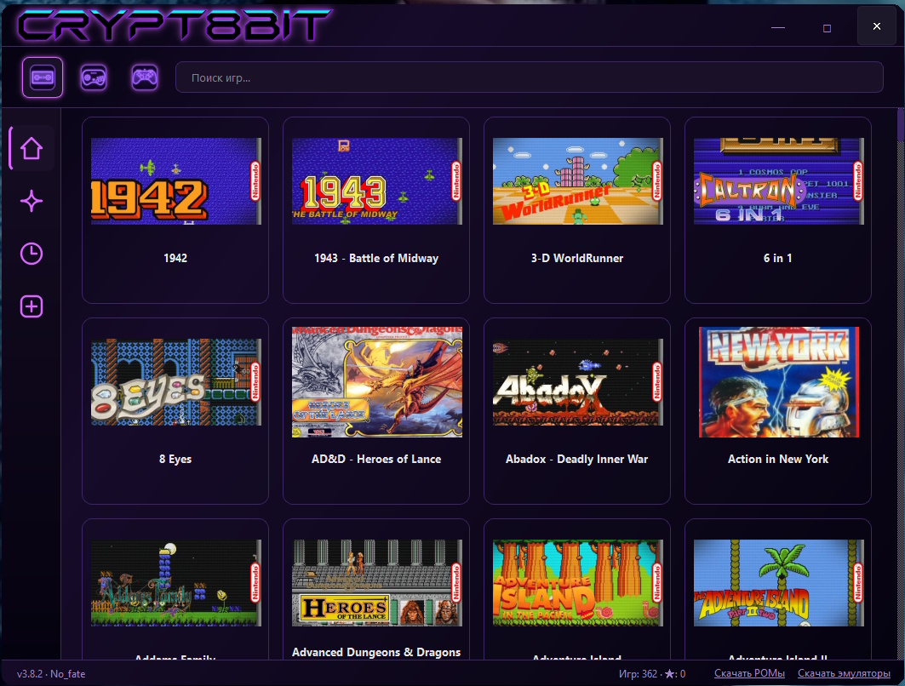
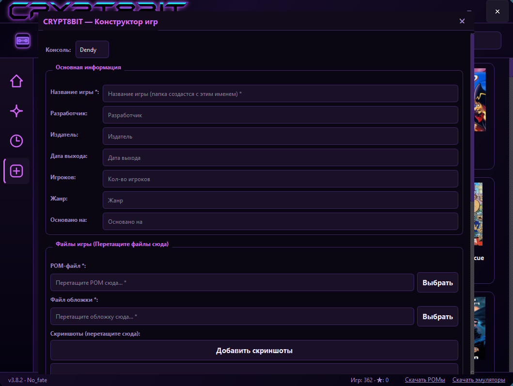
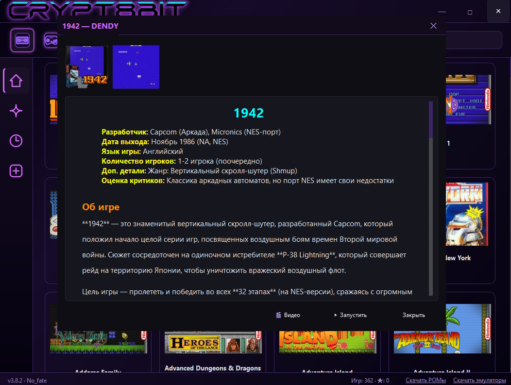

# CRYPT8BIT 🕹️

Портативный лаунчер ретро-игр для Dendy, Sega и Sony PlayStation, написанный на Python (PySide6) с неоновым интерфейсом в стиле Synthwave.

## ✨ Особенности
*   **Единый интерфейс:** Управление библиотекой игр трех консолей в одном окне.
*   **Synthwave-стиль:** Глубокий фиолетовый градиент, неоновые акценты и кастомный фреймлесс-интерфейс.
*   **Умный сканер:** Автоматически находит игры, обложки, скриншоты и описания (в формате HTML).
*   **Запуск в один клик:** Двойной клик по игре сворачивает лаунчер и открывает эмулятор.
*   **Встроенный конструктор:** Утилита для быстрого добавления новых игр и генерации для них красивых HTML-описаний.

## 🛠️ Стек
*   Python 3.12
*   PySide6 (Qt 6)
*   Стандартные библиотеки для работы с JSON и файловой системой.

## 🚀 Как запустить
1. Скачайте последний релиз из раздела [Releases](https://github.com/WithoutLife/CRYPT8BIT/releases).
2. Распакуйте архив.
3. Скачайте эмуляторы и РОМы по ссылкам в футере лаунчера.
4. Запустите `CRYPT8BIT.exe`.

## 📸 Скриншоты

Нажмите, чтобы посмотреть скриншоты

---
*Разработано для души. © 2025 No_fate.*
